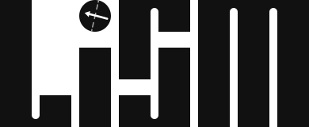
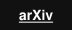
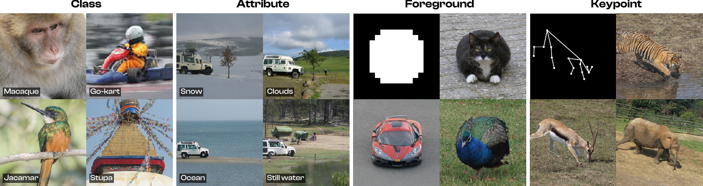

<p align="center">
  <picture>
    <source media="(prefers-color-scheme: dark)" srcset="assets/logo-dark.svg">
    
  </picture>
</p>

<h3 align="center">Linear Probes Can Guide: Training-Free Control of Representation Generators</h3>

<p align="center">Pengwei Wang&emsp;&emsp;José Morano&emsp;&emsp;Botond Fazecas&emsp;&emsp;Hrvoje Bogunović <br>
Medical University of Vienna
</p>

<p align="center">
  <a href="https://arxiv.org/abs/2611.33037"><picture><source media="(prefers-color-scheme: dark)" srcset="assets/button-arxiv-dark.svg"></picture></a>&nbsp;
  <a href="https://penway.cn/lism/"><picture><source media="(prefers-color-scheme: dark)" srcset="assets/button-project-dark.svg"></picture></a>&nbsp;
  <a href="https://huggingface.co/penway47/LiSM/"><picture><source media="(prefers-color-scheme: dark)" srcset="assets/button-huggingface-dark.svg"></picture></a>
</p>

<p align="center"></p>


LiSM (Linear Guidance in Semantic Mean-Space) guides a pretrained representation generator at sampling time with
linear probes. The generator works in the feature space of a frozen image encoder, so a probe fitted
on the encoder's clean features can be read directly on the generator's predicted clean latent. A
request becomes a set of linear conditions on that prediction, and the sampler is steered until they
hold.

- **No training of the generator, and no noise-aware classifier.** A linear probe fitted on clean
  features and a covariance of those features are all a request needs.
- **Global and local control with one method**: class, attributes, foreground masks, keypoints.
- **Your own request**: fit a probe on a folder of labelled images and guide with it.

## Setup

```sh
git clone --recursive https://github.com/penway/LiSM
pip install -e LiSM
```

The generator is [RAEv2](https://github.com/nanovisionx/RAEv2) (ImageNet 256 x 256, DINOv3-L
latents). Its code is the submodule `third_party/RAEv2`. Its checkpoints, about 13 GB, are downloaded
from the Hugging Face repository `nyu-visionx/RAEv2-models` on first use; to use a copy on disk, set
`LISM_RAE_WEIGHTS` to its folder. The first run also fetches the DINOv3 code from GitHub.

The prepared probes are downloaded from huggingface `penway47/LiSM`. To use a local copy, set
`LISM_TASKS` to its folder.

## Inference

```python
from pathlib import Path
from lism import load_task, mask_from_text, preset, sample, to_pil
from lism.backbones import load_rae

model = load_rae(class_id=281)                # the generator, conditioned on a class (tabby cat)
task = load_task("foreground")                # a fitted probe, its covariance and its settings
mask = mask_from_text(Path("examples/local_inputs/foreground_01.txt").read_text())
image = sample(model, task.request(mask), preset("fit", "path", task), seed=0)
to_pil(image).save("cat.png")
```

`preset("fit", "path", task)` is the method of the paper with the strength tuned for that probe.
`preset("fit", "id", task)` is faster, one network call per step instead of two, with weaker
control of masks and keypoints.

Four tasks are prepared:

| Task | `task.request(...)` takes |
|---|---|
| `class` | a class id (ImageNet, 0-999); load the generator without a class, `load_rae()` |
| `attributes` | `{"snow": 1, "trees": -1}`: present (+1) or absent (-1); load with `condition=<class id>` |
| `foreground` | a binary mask on the 16 x 16 latent grid |
| `keypoints` | `{"nose": (x, y), ...}` in image pixels; joints left out are not requested |

The attribute covariance depends on the class the generator is conditioned on. It is prepared for
eleven ImageNet classes: 7 (cock), 137 (American coot), 156 (Blenheim spaniel), 161 (basset),
278 (kit fox), 351 (hartebeest), 510 (container ship), 609 (jeep), 661 (Model T), 670 (motor scooter)
and 895 (warplane). Use the same id for `load_rae(class_id=...)` and `load_task("attributes", condition=...)`.

`examples/local_inputs/` has eight masks and seven poses as text files. To run all four tasks, or one
of these requests on four seeds:

```sh
python examples/four_tasks.py
python examples/local_input.py examples/local_inputs/keypoints_03.txt
```

## Fit your own probe

A request needs an affine probe and a Gaussian covariance, both fitted on clean latents of the
generator's encoder. Labels come from any dataset. The generator is not used.

```sh
python -m lism.extract IMAGES latents.npy --pooled
python -m lism.fit probe class latents.npy labels.npy my_task
python -m lism.fit cov pooled latents.npy my_task
```

This writes the task folder `my_task` with `probe.safetensors`, `covariance.safetensors` and
`config.json`. The four kinds of probe and their labels:

| Kind | Labels | Latents | Covariance |
|---|---|---|---|
| `class` | class id, `[N]` | pooled | `pooled` |
| `attributes` | 0 or 1 per attribute, `[N, A]` | pooled | `pooled` |
| `mask` | foreground on the latent grid, `[N, H, W]` | full (no `--pooled`) | `latent` |
| `keypoints` | pixel x, y and visibility per joint, `[N, J, 3]` | full | `latent` |

Guide with it:

```python
from lism import guide, load_task, sample
task = load_task("my_task", ".")
image = sample(model, task.request(3), guide("fit", "path", task.cov, alpha=1), seed=0)
```

`alpha` is the guidance strength. A new probe has no tuned one: for `fit` x `path`, values around 1
are usually a good start, and some probes need a wider search.

`examples/fit_your_own.py` does all of this for a class probe from a folder with one subfolder of
images per class:

```sh
python examples/fit_your_own.py IMAGES my_task
```

## Acknowledgements

The generator, its code and its checkpoints are from [RAEv2](https://github.com/nanovisionx/RAEv2).
We also thank the great work by [DINOv3](https://github.com/facebookresearch/dinov3) and [RAE](https://github.com/bytetriper/RAE).
